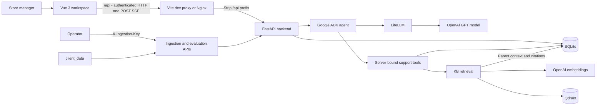
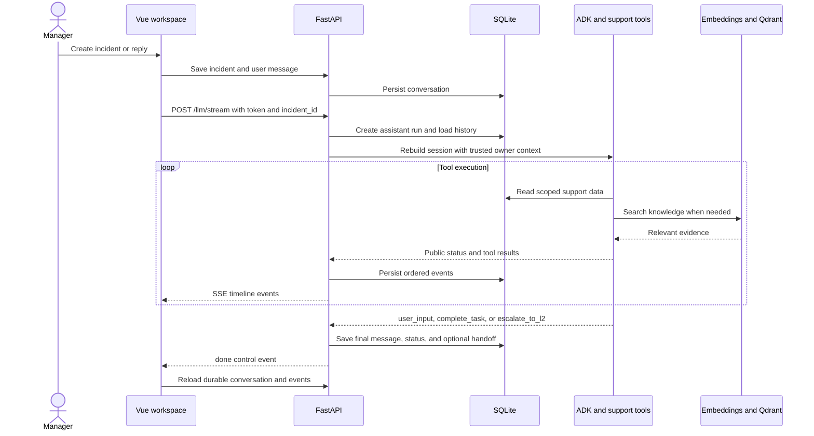

# ServeIQ — phData incident assistant

Agentic IT support for the synthetic ServeWell Hospitality dataset: a Vue workspace, FastAPI backend, grounded knowledge retrieval, and live agent-event streaming.

## Documentation

- [Backend](phdata/microservices/backend/README.md): configuration, ingestion, tools, API, evaluation, and tests.
- [Frontend](phdata/microservices/frontend/README.md): development, UI structure, proxying, and streaming.
- [Qdrant](phdata/microservices/qdrant/README.md): vector indexing and storage operations.
- [Dataset](client_data/README.md): inventory, schemas, and application data flow.
- [Project challenge](project_challenge.md): original requirements.

## Current capabilities

- Manager login, assigned-store context, incident history, and multi-turn support conversations.
- Model selection with a conversation-pinned model, live tool timeline, citations, and durable event history.
- Structured ingestion of stores, assets, SLAs, versions, and historical tickets into SQLite.
- Markdown KB ingestion with parent/child chunking, OpenAI embeddings, and Qdrant similarity search.
- Google ADK agent using LiteLLM for OpenAI GPT models and server-bound support tools.
- Clarification, resolution, and **simulated** L2 handoff outcomes with an audit trail.
- Privileged, bounded evaluation runs for curated, training, or custom scenarios.

L2 escalation records a handoff locally; **no real L2 team or external ITSM dispatcher is contacted**. Streaming exposes public status/tool events, not token-by-token provider output or private reasoning.

## Architecture



### One support turn



## Repository structure

```text
.
├── README.md
├── project_challenge.md
├── client_data/                   # Reference data, KB, tickets, evaluation labels
├── phdata/
│   ├── microservices/
│   │   ├── backend/               # Standalone uv project; FastAPI, ADK, tests
│   │   ├── frontend/              # Vue 3 + Vite; Nginx production serving
│   │   └── qdrant/                # Pinned vector-store image and configuration
│   └── deploy/                    # Kubernetes Deployments, Services, PVCs
├── skaffold.yaml                  # Local builds, deployment, port forwarding
├── pyproject.toml                 # Root project; not the backend runtime project
└── src/phdata2/                   # Root Python package
```

## Local development

### 1. Configure and start the backend

Prerequisites: Python 3.12, [uv](https://docs.astral.sh/uv/), Node.js 22.12+ with npm, and a reachable Qdrant instance for KB operations. The included Kubernetes deployment supplies Qdrant; see [deployment](#rancher-desktop-deployment).

From the repository root:

```bash
uv sync --project phdata/microservices/backend --extra dev
cd phdata/microservices/backend
cp .env.example .env
mkdir -p data
```

Edit the backend environment file, following [.env.example](phdata/microservices/backend/.env.example):

- Set a private `JWT_SECRET` of at least 32 characters.
- Set `OPENAI_API_KEY` for agent calls and embeddings.
- Set a private `INGESTION_API_KEY` to enable ingestion and evaluations.
- Keep `DATASET_ROOT=../../../client_data` when running from the backend directory.
- Set `QDRANT_URL` to the reachable store, locally `http://localhost:6333`.
- Choose account-accessible `LLM_MODEL` and `ALLOWED_MODELS` values. The configured default is `gpt-6.1-sol`; configuration is not proof of provider availability.

Never commit environment files or credentials. Authentication and basic incident operations do not need OpenAI or Qdrant; grounded support requires ingestion and provider access.

Run from the backend directory so the environment file and relative database path resolve correctly:

```bash
uv run uvicorn main:app --host 0.0.0.0 --port 8000
```

API schemas: <http://localhost:8000/docs>. Default database: `./data/phdata.db`, relative to the backend working directory.

### 2. Ingest the dataset

With the backend and Qdrant running, use a separate terminal. Set `INGESTION_API_KEY` in that shell to the same private value configured on the backend; the environment file is not automatically exported to your shell.

```bash
curl --fail-with-body -X POST http://localhost:8000/ingestion/all \
  -H "X-Ingestion-Key: $INGESTION_API_KEY"
curl --fail-with-body http://localhost:8000/ingestion/status \
  -H "X-Ingestion-Key: $INGESTION_API_KEY"
curl --fail-with-body http://localhost:8000/ingestion/managers \
  -H "X-Ingestion-Key: $INGESTION_API_KEY"
```

Structured ingestion provisions demo manager accounts and assigns stores/history. Pick an email returned by `/ingestion/managers`; newly provisioned accounts use the demo password `operator`. Existing credentials are preserved. **These accounts are for local synthetic-data use only.** KB ingestion makes billable embedding requests. For structured-only setup, use `POST /ingestion/structured`, then separately run `POST /ingestion/kb`.

### 3. Start the frontend

From the repository root in another terminal:

```bash
cd phdata/microservices/frontend
npm ci
npm run dev
```

Open <http://localhost:5173>, sign in with a provisioned manager, and create an incident. Vite proxies `/api` to the backend; provider and ingestion keys remain server-side. The UI supports login, not self-service registration; API registration alone does not assign manager stores.

## API overview

| Area | Routes | Access |
| --- | --- | --- |
| Health | `GET /health` | Public; process health only |
| Accounts | `/users/register`, `/users/login`, `/users/me`, `GET /users` | Register/login public; remaining routes bearer-authenticated |
| Conversations | `/incidents`, `/incidents/{id}/messages`, `/messages/{id}/events` | Bearer token; owner-scoped |
| Agent | `GET /llm/models`, `POST /llm/stream` | Bearer token; incident ownership checked |
| Reference data | `/data/me`, `/data/stores`, `/data/assets`, `/data/sla`, `/data/system-versions`, `/data/tickets` | Bearer token; store/assets/history scoped to manager |
| Knowledge | `GET /kb/search` | Bearer token |
| L2 handoffs | `/escalations`, `/escalations/stats`, `/escalations/{id}` | Bearer token; owner-scoped |
| Ingestion | `/ingestion/*` | `X-Ingestion-Key` |
| Evaluation | `/evaluations/*` | `X-Ingestion-Key` |

`GET /users` exposes an authenticated directory of user IDs/emails, not password hashes. See the [backend guide](phdata/microservices/backend/README.md) and running OpenAPI docs for payloads and pagination.

## Rancher Desktop deployment

Prerequisites: Rancher Desktop with Kubernetes enabled, the `rancher-desktop` context, a Docker-compatible image builder, kubectl, Skaffold supporting `skaffold/v4beta11`, and a default dynamic storage provisioner. Locally built images are not pushed; the Kubernetes runtime must be able to access them.

An administrator must first provision a Kubernetes Secret named `phdata-backend-secrets` in the deployment namespace:

| Secret key | Purpose |
| --- | --- |
| `JWT_SECRET` | Required at startup; at least 32 characters |
| `OPENAI_API_KEY` | Optional at startup; required for agent calls and embeddings |
| `INGESTION_API_KEY` | Optional at startup; required for ingestion and evaluations |

Use your organization's secret-management workflow. No real credentials or Secret manifest are included. Restart the backend after changing injected Secret values. All resources and the Secret must use the same namespace.

From the repository root:

```bash
skaffold dev --port-forward
```

Use `skaffold run --port-forward` for a one-off deployment instead. Frontend: <http://localhost:5173>; API: <http://localhost:8000/docs>; Qdrant: <http://localhost:6333>. Nginx proxies browser `/api` requests to `http://phdata-backend:8000`; the backend uses `http://phdata-qdrant:6333`. Run ingestion after first deployment; packaging the dataset does not ingest it automatically.

### Persistence and boundaries

- Backend: one replica, `Recreate`, SQLite at `/app/data/phdata.db`, 1 GiB `ReadWriteOnce` claim `phdata-backend-data`.
- Qdrant: one replica, `Recreate`, vectors at `/qdrant/storage`, separate 1 GiB claim `phdata-qdrant-data`.
- Skaffold's pre-deploy hook applies PVCs outside its cleanup-managed manifest list, so normal Skaffold cleanup is intended to retain them. Manual claim deletion or cluster reset can still destroy data. Back up both stores before teardown.
- Do not scale the backend or enable autoscaling: SQLite and filesystem run locks are not distributed coordination.
- Qdrant has no API key configured; keep it local/private. Backend TCP readiness and `/health` do not verify the provider or retrieval pipeline.
- Production use needs credential hardening (including demo accounts), TLS, managed secrets, backups, and a shared database/coordination design before scaling.

## Validation and troubleshooting

See [backend tests and evaluation](phdata/microservices/backend/README.md#testing-and-evaluation) and [frontend validation](phdata/microservices/frontend/README.md#validation).

| Symptom | Check |
| --- | --- |
| Backend fails at startup | `JWT_SECRET` length and backend working directory |
| UI cannot reach API | Backend port 8000; Vite proxy locally or Nginx service DNS in Kubernetes |
| Empty manager workspace | Structured ingestion completed; use a provisioned manager account |
| Ingestion/evaluation returns 503 | Backend ingestion key configured; dataset path exists |
| Ingestion returns 401 | Shell header value matches backend ingestion key |
| KB ingestion/search fails | OpenAI key, embedding access, Qdrant connectivity, collection dimensions |
| Stream fails or stops | Allowed model/access, credentials, run limits; refresh durable history before retrying |
