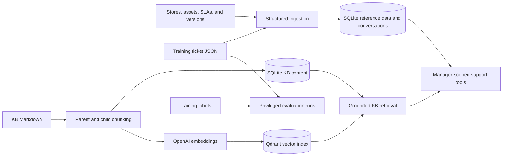

# ServeWell IT Support — Synthetic Dataset

Synthetic data package for the **phData Applied AI Solutions Architect** project challenge. ServeIQ uses it for agentic IT support triage for ServeWell Hospitality, a fictional multi-brand QSR chain.

[Project overview](../README.md) · [Backend ingestion and retrieval](../phdata/microservices/backend/README.md#ingestion-and-retrieval)

## Application data flow



Runtime ingestion is explicit: `POST /ingestion/structured` loads reference data and training tickets; `POST /ingestion/kb` indexes Markdown; `POST /ingestion/all` runs both stages. These endpoints require `X-Ingestion-Key`; KB indexing also requires OpenAI credentials and Qdrant. See the [setup guide](../README.md#local-development).

Training labels are evaluation ground truth, not runtime retrieval evidence. Structured ingestion provisions missing demo manager accounts, assigns stores, and imports historical incidents. Existing credentials and conversations are preserved on repeat ingestion.

---

## What's In This Package

```text
client_data/
├── data/
│   ├── stores.csv         120 India store locations (franchise + corporate)
│   ├── assets.csv         477 IT assets
│   └── sla_matrix.csv     28 priority/category SLA rows
├── kb/                    48 Markdown documents total
│   ├── runbooks/          32 issue-specific runbooks
│   ├── faq/               6 category FAQs
│   ├── sop/               3 escalation/shift procedures
│   └── system-specs/      7 spec sheets + version-matrix.csv (21 version rows)
├── tickets/
│   ├── train/             256 ticket JSON files
│   └── train_index.csv    256 training index entries
└── labels/
    └── train_labels.json  Ground-truth training labels
```

Counts describe the current checkout. There is no `tickets/raw/` directory in this package. The index retains original `raw/INC-NNNNN.json` filenames; resolve each basename under [tickets/train/](tickets/train/) instead. The backend structured importer reads that directory directly.

---

## Ticket Schema

Each `INC-NNNNN.json` file contains a rich ITSM ticket:

```json
{
  "ticket_id": "INC-00142",
  "store_id": "SW-0412",
  "store_name": "ServeWell - Koramangala",
  "submitted_by": "Maria Chen",
  "contact_phone": "+91-98765-43210",
  "date_opened": "2025-11-14T09:32:00+05:30",
  "priority": "P2",
  "category": "POS",
  "subcategory": "Terminal Startup",
  "subject": "POS terminal 2 won't start after power outage",
  "description": "...",
  "asset_id": "POS-0412-T2",
  "system_version": "FoodTech POS v4.2.1",
  "tags": ["pos", "startup", "power"],
  "escalation_flag": false,
  "related_tickets": [],
  "ticket_history": [...],
  "resolution_notes": null,
  "status": "Open"
}
```

---

## Label Schema

```json
{
  "ticket_id": "INC-00142",
  "correct_routing": "l1_guided",
  "relevant_kb_docs": ["runbooks/pos-startup-failure.md"],
  "should_escalate": false,
  "escalation_reason": null,
  "correct_resolution_summary": "Follow cold-start steps in pos-startup-failure.md...",
  "expected_agent_action": "retrieve_runbook_and_guide",
  "evaluator_notes": "Agent should retrieve pos-startup-failure.md before any remote actions."
}
```

`correct_routing` values: `l1_self_service`, `l1_guided`, `l2_escalation`, `non_it`, `needs_clarification`

---

## Loading the Data

For application setup, use the [backend ingestion APIs](../phdata/microservices/backend/README.md#ingestion-and-retrieval). For standalone exploration, run this example from the repository root. It reads local files only; it does not provision accounts or create a vector index.

```python
import csv
import json
from pathlib import Path

ROOT = Path("client_data")

train_tickets = []
with (ROOT / "tickets/train_index.csv").open(encoding="utf-8", newline="") as index_file:
    for row in csv.DictReader(index_file):
        ticket_path = ROOT / "tickets/train" / Path(row["filename"]).name
        with ticket_path.open(encoding="utf-8") as ticket_file:
            train_tickets.append(json.load(ticket_file))

with (ROOT / "labels/train_labels.json").open(encoding="utf-8") as label_file:
    train_labels = json.load(label_file)

with (ROOT / "data/stores.csv").open(encoding="utf-8", newline="") as store_file:
    stores = list(csv.DictReader(store_file))

with (ROOT / "data/assets.csv").open(encoding="utf-8", newline="") as asset_file:
    assets = list(csv.DictReader(asset_file))
```

---

## Systems in the Dataset

| Domain        | Systems                                                     |
| ------------- | ----------------------------------------------------------- |
| POS           | FoodTech POS v4.2.x, v5.1.x · OrbitPOS v2.x                 |
| Soft Serve    | CreamTech SC-300 · CreamTech SC-500 · FrostyPro 800         |
| Online Orders | ServeWell Online Portal v3.x · Zomato / Swiggy integrations |
| Network       | NetLink NL-3000 · Cisco SG350                               |
| Printers      | EpsonTM-T88VI · StarMC Print v2                             |
| Kiosks        | ServeWell Kiosk v2.x · TouchPoint K1                        |

---

## Ticket coverage and evaluation

The training subset contains 256 tickets across POS, Soft Serve, Online Orders, Wi-Fi / Network, Printers, and Kiosks. Use [train_index.csv](tickets/train_index.csv) for the current category/priority distribution rather than estimates for the original full dataset.

Tickets mix thorough and sparse reports, L1 self-service and L2 escalation, and P1–P4 priorities. Ground-truth labels identify expected routing, relevant KB documents, and escalation decisions. The backend's training evaluation suite uses tickets and labels; curated/custom suites exercise additional multi-turn and failure scenarios. See [testing and evaluation](../phdata/microservices/backend/README.md#testing-and-evaluation).

## Handling notes

- All records describe a fictional organization; they are not live operational data.
- Preserve source IDs and relative KB paths so historical links and evaluation expectations remain valid.
- Markdown is grounded support evidence; ticket descriptions and imported text are data, not trusted agent instructions.
- Demo manager credentials are for local use only. Do not expose a deployment containing them as a production service.

